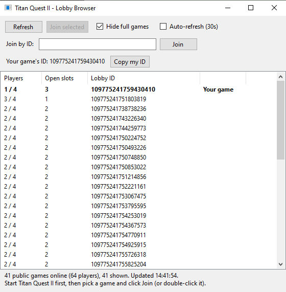

# Titan Quest II Lobby Browser

A tiny, unofficial server browser for **Titan Quest II** on Steam. It shows every public multiplayer game that's open right now and lets you join one with a double-click.



## Download

Get **`TQ2LobbyBrowser.exe`** from the [latest release](../../releases/latest). That's the only file you need.

## Requirements

- Windows 10 or 11
- Steam running and logged in
- Titan Quest II installed through Steam

You don't need to install anything else. No Python or extra runtime is required, and the browser doesn't need to be in the game folder.

## How to use

1. **Start Titan Quest II** and go to the main menu.
2. Run `TQ2LobbyBrowser.exe`. It searches for open games right away.
3. Pick a game and click **Join selected**, or double-click it. Steam hands the join to the game.

| Option | What it does |
| --- | --- |
| **Refresh** | Searches again for open games worldwide |
| **Hide full games** | Hides games that have no free slots (on by default) |
| **Auto-refresh (30s)** | Refreshes the list every 30 seconds |
| **Join by ID** | Paste a lobby ID (or a `steam://joinlobby/...` link) and click **Join** |
| **Copy my ID** | Copies the ID of the game you're hosting or playing in |
| **Right-click / Ctrl+C** | Copies the ID of the selected game in the list |

### Playing with people who aren't on your Steam friends list

You don't need to add anyone as a Steam friend:

1. **Host:** start a multiplayer game set to **Public**, then click **Refresh** in the browser. Your game shows at the top of the list as **Your game**. Click **Copy my ID** and paste the ID into Discord, a forum or a chat.
2. **Everyone else:** start Titan Quest II, paste the ID into **Join by ID** and click **Join**.

The host's game needs to be **Public**. Steam doesn't let strangers into friends-only or private lobbies, even if they have the ID.

### "Windows protected your PC"

The exe isn't code-signed, so Windows SmartScreen may warn you the first time you run it. Click **More info**, then **Run anyway**. If you'd rather not, you can build it yourself from the source (see below).

## What it can and can't show

The game only publishes a lobby ID and the player count for each game. That means the browser can't show the host's name, difficulty, level or quest progress. Friends-only and private games are hidden by Steam, so only public games appear.

## How it works

- It finds your Titan Quest II install through Steam and loads Valve's `steam_api64.dll` from the game's own folder. No game or Steam files are included or modified.
- It asks Steam for the game's public lobbies (AppID `1154030`), worldwide.
- **Join** opens a `steam://joinlobby/1154030/<lobby id>` link, which is the same thing that happens when you accept a friend's invite.
- It only connects to Steam while searching and disconnects afterwards. That way Steam won't think the game is already running when you click Play.

## Building from source

There's one source file, and the compiler that ships with Windows can build it:

```bat
C:\Windows\Microsoft.NET\Framework64\v4.0.30319\csc.exe /target:winexe /platform:x64 /optimize+ /out:TQ2LobbyBrowser.exe TQ2LobbyBrowser.cs
```

## Disclaimer

This is a fan-made tool. It isn't affiliated with or endorsed by THQ Nordic, Grimlore Games or Valve. A game update could change how multiplayer lobbies work and stop it from working.
